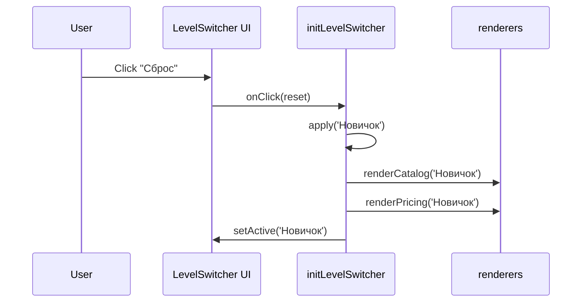

# Design

## Context

Существующий `initLevelSwitcher` управляет активным уровнем и обновляет «Программу» и «Тарифы». Требуется добавить действие «Сброс» для программной установки уровня «Новичок» без изменений архитектуры.

## Goals / Non-Goals

Goals:
- Реализовать сброс уровня к «Новичок» в UI и логике переключателя.
- Сохранить доступность (aria-selected, tabindex), одностраничность и отсутствие ошибок.

Non-Goals:
- Нет изменений в данных (`src/data/*`) и калькуляторе времени; нет хранения состояния.

## Decisions

- Кнопка `#level-reset` добавляется в зону `#level-switcher`.
- В `initLevelSwitcher` навесить обработчик клика: `apply('Новичок')`.
- Не меняем сигнатуры экспортов; используем существующие `renderCatalog`/`renderPricing`.

## Взаимодействие (Mermaid)

## Risks / Trade-offs

- Непредусмотренный DOM: если отсутствуют контейнеры, обработчик не должен падать — проверка уже есть в коде (наличие элементов).
- Дублирование состояния при быстрых кликах — `apply` идемпотентен для «Новичок».
