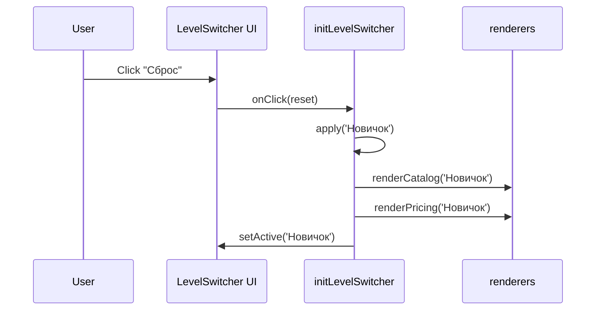

# Design: diff формы (до → после правила Mermaid)

- Добавлен раздел «Взаимодействие (Mermaid)» с диаграммой последовательностей, отражающей поток: Click «Сброс» → apply('Новичок') → renderCatalog/renderPricing → setActive.
- Остальные разделы (Context, Goals/Non-Goals, Decisions, Risks) по смыслу не изменены — обновлена только форма представления взаимодействий согласно правилу проекта.

См. исходник «до»: practices/practice_05/artifacts/openspec/design-before.md
И актуальный design: practices/practice_04/openspec/changes/archive/2026-10-27-reset-level-to-default/design.md

Выдержка из актуального design (Mermaid):

